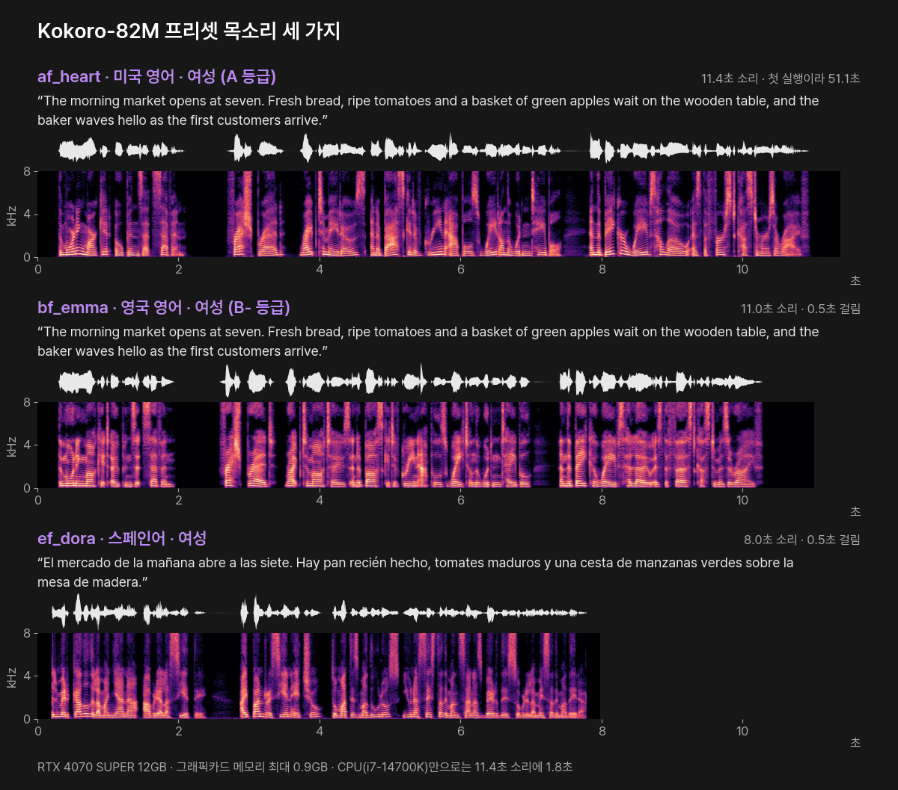
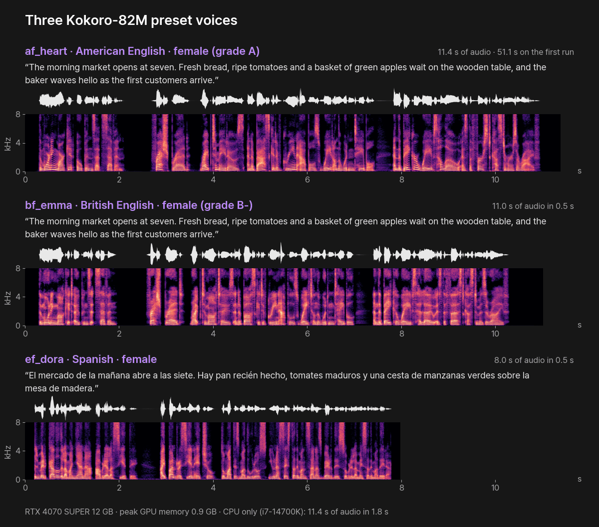

# Kokoro-82M — 가벼운 프리셋 목소리 (PromBoard 플러그인)

[English](#english)

글을 읽어 목소리(WAV)로 만드는 PromBoard 커뮤니티 플러그인입니다. hexgrad 의 오픈 모델 [Kokoro-82M](https://huggingface.co/hexgrad/Kokoro-82M)(82M, 0.33GB)을 이 PC 에서 돌립니다. 공식 프리셋 목소리 41개 중 하나를 고릅니다. 모델이 작아 그래픽카드 없이 CPU 로도 빠르게 돌고, 모델이 Apache-2.0 이라 상업에도 쓸 수 있습니다.



같은 노드에서 목소리만 바꿔 읽혔습니다. 각 소리의 위 띠는 파형, 아래 띠는 스펙트로그램(가로 = 시간, 세로 = 소리 높낮이, 밝을수록 큰 소리)입니다. 듣기: [af_heart](docs/ko/audio/af-heart-en.mp3?raw=true) · [bf_emma](docs/ko/audio/bf-emma-en.mp3?raw=true) · [ef_dora](docs/ko/audio/ef-dora-es.mp3?raw=true) (링크를 누르면 mp3 를 내려받습니다 — GitHub 화면은 소리를 재생하지 않습니다.)

- 플러그인 id: `promboard.kokoro`
- 필요한 앱: PromBoard 1.0.3 이상
- 지원 언어: 미국 영어 · 영국 영어 · 스페인어 · 프랑스어 · 힌디어 · 이탈리아어 · 브라질 포르투갈어. **한국어는 없습니다.**
- 라이선스: 플러그인 코드 GPL-3.0-or-later(발음 변환에 쓰는 phonemizer · espeak-ng 가 GPL-3.0 이라 따릅니다). 모델은 Apache-2.0

## 받는 것과 용량

| 무엇 | 출처 | 크기 | 라이선스 |
|---|---|---|---|
| Kokoro-82M 모델 · 설정 · 목소리 41개 | [hexgrad/Kokoro-82M](https://huggingface.co/hexgrad/Kokoro-82M) | 0.35GB | Apache-2.0 |
| 영어 품사 모델 en_core_web_sm 3.7.1 | [spacy/en_core_web_sm](https://huggingface.co/spacy/en_core_web_sm) | 15MB | MIT |
| 파이썬 패키지(PyTorch 2.8 · kokoro · misaki · spaCy · espeak-ng 등) | PyPI · PyTorch | 약 3GB(다른 플러그인과 같은 PyTorch 는 다시 받지 않습니다) | 각 패키지 |

espeak-ng 는 `espeakng-loader` 휠에 들어 있어 따로 설치하지 않습니다(Windows · Linux · macOS 같음).

## 필요한 그래픽카드 메모리

그래픽카드가 없어도 됩니다. 그래픽카드로 돌리면 최대 0.9GB(실측)를 쓰고, CPU 만으로도 11초 소리를 2초 안에 만듭니다.

## 쓰는 법

노드 추가 목록에서 「Kokoro 목소리」를 놓고 글 노드를 '읽을 글'에 이은 뒤 ▷ 를 누릅니다.

| 설정 | 고르는 것 | 뜻 |
|---|---|---|
| 목소리 | 41개(언어 · 성별 · 이름 · 공식 등급) | 언어는 목소리마다 정해져 있습니다. 글은 고른 목소리의 언어로 씁니다. 등급은 공식 [VOICES.md](https://huggingface.co/hexgrad/Kokoro-82M/blob/main/VOICES.md)의 종합 등급(A 가 가장 좋음)이고, 스페인어 · 포르투갈어 목소리는 등급이 없습니다 |
| 빠르기 | 0.5 ~ 2 | 1 보다 크면 빠르게 읽습니다 |

- 글은 20,000자까지 받습니다. 줄을 바꾸면 그 자리에서 끊어 읽습니다.
- 목소리 복제는 없습니다(공식 모델이 프리셋만 냅니다).

## 실측

PromBoard 앱에서 실제로 돌려 쟀습니다(앱 1.0.3-beta 의 실행 경로 그대로, RTX 4070 SUPER 12GB · i7-14700K · Windows 11). CPU 줄은 같은 노드 코드를 그래픽카드 없이 직접 돌린 값입니다. 만든 소리를 Whisper large-v3-turbo 로 다시 받아써 원문과 비교했습니다.

| 경우 | 글 | 만든 소리 | 걸린 시간 | 그래픽카드 메모리 최대 | 받아쓰기 비교 |
|---|---|---|---|---|---|
| af_heart · 미국 영어 (첫 실행) | 173자 | 11.4초 | 51.1초 | 0.9GB | 같음(seven 을 7 로 받아씀) |
| bf_emma · 영국 영어 | 173자 | 11.0초 | 0.5초 | 0.9GB | 같음 |
| ef_dora · 스페인어 | 135자 | 8.0초 | 0.5초 | 0.9GB | 같음(siete 를 7 로 받아씀) |
| af_heart · CPU 만 | 173자 | 11.4초 | 1.8초(첫 실행 25.9초) | — | 같음 |

- 첫 실행은 모델을 올리고(17초) 발음 변환기 · 영어 품사 모델을 처음 준비하느라 오래 걸립니다. 그다음부터는 위처럼 1초 안팎입니다.

## 빠진 언어

Kokoro 1.0 에는 일본어 · 중국어 목소리도 있지만 이 플러그인에서는 뺐습니다. 일본어 · 중국어 글을 발음으로 바꾸는 패키지(pyopenjtalk · unidic · jieba)가 소스 코드로만 배포되어, PromBoard 실행 준비 방식(미리 빌드된 휠만 설치)으로 깔 수 없기 때문입니다.

## 라이선스와 조건

- 모델 · 목소리: Apache-2.0(상업 가능). 프랑스어 목소리 ff_siwis 는 SIWIS 데이터(CC BY 4.0)로 학습했습니다(공식 카드 「Creative Commons Attribution」).
- 플러그인 코드: GPL-3.0-or-later. 발음 변환에 쓰는 phonemizer-fork(GPL-3.0-or-later)와 espeak-ng(GPL-3.0-or-later, espeakng-loader 휠에 포함)를 따릅니다.

## 파일

```
manifest.json                 플러그인 정보 · 노드 정의 · 받을 모델
icon.png
nodes/main.py                 노드 코드
nodes/requirements.in         직접 쓰는 패키지
nodes/requirements-*.txt      운영체제별 해시 잠금 파일(uv pip compile --generate-hashes, Python 3.12)
docs/                         이 README 의 그림 · 소리(ko · en). 플러그인 zip 에는 넣지 않는다
docs/scripts/                 위 그림 · mp3 를 노드 결과 WAV 로 다시 만드는 스크립트(make_visuals.py)와 그림 설정(hero.json)
```

README 그림 · 소리 다시 만들기: 노드 결과 WAV 를 hero.json 의 `wav` 이름으로 docs/scripts 에 두고 `python docs/scripts/make_visuals.py docs/scripts/hero.json docs ko`(영어판은 `en`)를 실행합니다(numpy · scipy · matplotlib · Pillow · ffmpeg · Pretendard 글꼴).

레지스트리에 올리는 zip 은 PromBoard 앱 저장소의 `server/src/tools/packPlugin.ts` 로 만듭니다. `git archive HEAD` 로 꺼낸 폴더를 넘기면 `.gitattributes` 의 `export-ignore` 로 `docs/` 가 빠집니다.

---

## English

**Kokoro-82M — lightweight preset voices** is a PromBoard community plugin that turns text into speech (WAV) with hexgrad's open [Kokoro-82M](https://huggingface.co/hexgrad/Kokoro-82M) model (82M, 0.33 GB), running on this PC. Pick one of the 41 official preset voices. The model is small enough to run quickly on the CPU without a graphics card, and it is Apache-2.0, so commercial use is allowed.



Same node, only the voice changed. For each sound the upper strip is the waveform and the lower strip is the spectrogram (time to the right, pitch upward, brighter = louder). Listen: [af_heart](docs/en/audio/af-heart-en.mp3?raw=true) · [bf_emma](docs/en/audio/bf-emma-en.mp3?raw=true) · [ef_dora](docs/en/audio/ef-dora-es.mp3?raw=true) (The links download the mp3 files; GitHub does not play audio on the page.)

- Plugin id: `promboard.kokoro`
- Requires PromBoard 1.0.3 or later
- Languages: American English · British English · Spanish · French · Hindi · Italian · Brazilian Portuguese. **No Korean.**
- License: plugin code GPL-3.0-or-later (it follows phonemizer and espeak-ng, used for pronunciation). Model: Apache-2.0.

### Downloads

| What | Source | Size | License |
|---|---|---|---|
| Kokoro-82M weights · config · 41 voices | [hexgrad/Kokoro-82M](https://huggingface.co/hexgrad/Kokoro-82M) | 0.35 GB | Apache-2.0 |
| English POS model en_core_web_sm 3.7.1 | [spacy/en_core_web_sm](https://huggingface.co/spacy/en_core_web_sm) | 15 MB | MIT |
| Python packages (PyTorch 2.8, kokoro, misaki, spaCy, espeak-ng, …) | PyPI · PyTorch | about 3 GB (PyTorch shared with other plugins is not downloaded again) | per package |

espeak-ng ships inside the `espeakng-loader` wheel, so nothing else is installed (same on Windows, Linux and macOS).

### GPU memory

No graphics card needed. On a GPU it uses at most 0.9 GB (measured); on the CPU alone it makes 11 s of audio in under 2 s.

### Use

Add the **Kokoro 목소리** node, connect a text node to **읽을 글** (text to read) and press ▷. Settings: **목소리** (voice: language · gender · name · official grade from [VOICES.md](https://huggingface.co/hexgrad/Kokoro-82M/blob/main/VOICES.md), A is best; Spanish and Portuguese voices have no grade) and **빠르기** (speed, 0.5–2). Write the text in the language of the chosen voice. Up to 20,000 characters; a line break makes a pause. No voice cloning (the official model ships presets only). The setting labels inside the app are in Korean for now (the plugin format takes one language).

### Measured

Measured inside the PromBoard app (the app's own run path, app 1.0.3-beta, RTX 4070 SUPER 12 GB, i7-14700K, Windows 11). The CPU row runs the same node code directly without a GPU. Each result was transcribed back with Whisper large-v3-turbo and compared with the input text.

| Case | Text | Audio | Time | Peak GPU memory | Transcription check |
|---|---|---|---|---|---|
| af_heart · American English (first run) | 173 chars | 11.4 s | 51.1 s | 0.9 GB | identical ("seven" transcribed as 7) |
| bf_emma · British English | 173 chars | 11.0 s | 0.5 s | 0.9 GB | identical |
| ef_dora · Spanish | 135 chars | 8.0 s | 0.5 s | 0.9 GB | identical ("siete" transcribed as 7) |
| af_heart · CPU only | 173 chars | 11.4 s | 1.8 s (first run 25.9 s) | — | identical |

- The first run loads the model (17 s) and prepares the phonemizer and the English tagger, so it takes longer. After that it takes about a second, as above.

### Languages left out

Kokoro 1.0 also has Japanese and Chinese voices, but this plugin leaves them out: the packages that turn Japanese and Chinese text into pronunciation (pyopenjtalk, unidic, jieba) are published as source code only, and PromBoard's prepare step installs prebuilt wheels only.

### License and conditions

- Model and voices: Apache-2.0 (commercial use allowed). The French voice ff_siwis was trained on SIWIS data (CC BY 4.0) — official card, "Creative Commons Attribution".
- Plugin code: GPL-3.0-or-later, following phonemizer-fork (GPL-3.0-or-later) and espeak-ng (GPL-3.0-or-later, bundled in the espeakng-loader wheel).

The `docs/` folder holds the pictures and sounds for this README and is left out of the plugin zip (`git archive HEAD` + `export-ignore`).
